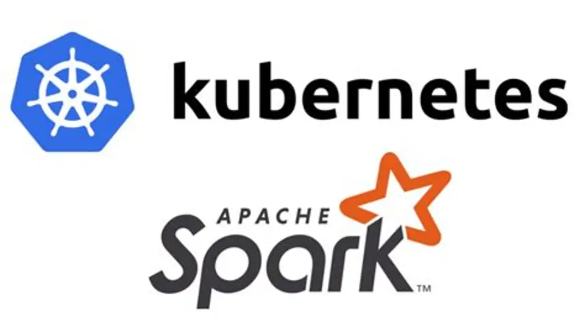
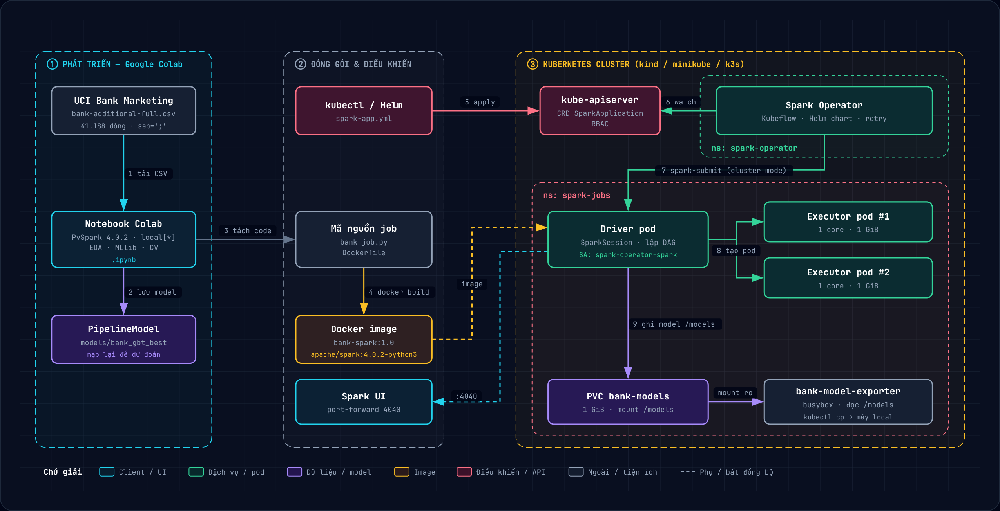
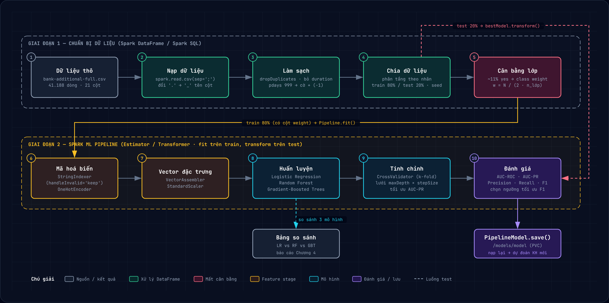

# Kiến trúc dự án: Bank Marketing Spark on Kubernetes

<p align="center">
  
</p>

> Dành cho người mới bắt đầu với Apache Spark và Kubernetes.  
> Mục tiêu: hiểu **tại sao** từng thành phần tồn tại trước khi đọc code.

---

## Dự án này làm gì?

Dự án huấn luyện mô hình Machine Learning dự đoán khách hàng có đăng ký tiền gửi ngân hàng hay không (`yes`/`no`), dựa trên bộ dữ liệu **UCI Bank Marketing** (41.188 dòng, 21 cột).

Điểm đặc biệt: toàn bộ quá trình tính toán chạy trên **Apache Spark** bên trong một cụm **Kubernetes** — giống như chạy trên "đám mây mini" ngay trên máy tính cá nhân.

---

## Tổng quan kiến trúc — 3 vùng



---

## Vùng 1 — Phát triển (Google Colab)

| Thành phần | Vai trò |
|---|---|
| `bank-additional-full.csv` | Dữ liệu gốc — 41.188 dòng, dấu phân cách `;` |
| Notebook Colab | Viết và chạy thử code PySpark 4.0.2 ở chế độ `local[*]` |
| `PipelineModel` | Kết quả: model GBT tốt nhất, lưu tại `models/bank_gbt_best` |

**Tại sao dùng Colab?** Để thử nghiệm nhanh mà không cần dựng cụm Kubernetes ngay. Khi code ổn định mới chuyển lên K8s.

---

## Vùng 2 — Đóng gói & Điều khiển

| Thành phần | Vai trò |
|---|---|
| `src/bank_job.py` | Script Python chính — đọc CSV, train model, lưu kết quả |
| `Dockerfile` | Đóng gói `bank_job.py` vào image `bank-spark:1.0` (nền `apache/spark:4.0.2-python3`) |
| `k8s/spark-app.yml` | Khai báo `SparkApplication` — Kubernetes CRD do Spark Operator cung cấp |
| `kubectl apply` | Lệnh gửi manifest lên cụm, bắt đầu toàn bộ quá trình |
| `Spark UI :4040` | Giao diện web theo dõi tiến trình job (truy cập qua `kubectl port-forward`) |

**Tại sao đóng gói vào Docker?** Kubernetes không chạy file Python trực tiếp — nó chạy **container**. Docker image chứa đủ Python, Spark, và code của bạn.

---

## Vùng 3 — Kubernetes Cluster

Đây là "trái tim" của dự án. Kubernetes quản lý các **pod** (đơn vị chạy nhỏ nhất, tương tự container).

### 3.1 Spark Operator (`ns: spark-operator`)

```
kubectl apply spark-app.yml
        │
        ▼
kube-apiserver  ──watch──►  Spark Operator
(nhận CRD SparkApplication)   (đọc spec, tạo Driver pod)
```

**Spark Operator** là một controller chạy trong namespace `spark-operator`. Nhiệm vụ: theo dõi các object `SparkApplication`, tự động tạo Driver và Executor khi thấy spec mới.

> **Analogie cho người mới:** Spark Operator giống "quản đốc" — bạn giao việc (spark-app.yml), nó tự sắp xếp nhân công (pod).

### 3.2 Driver pod (`ns: spark-jobs`)

```
Driver pod
├── Khởi tạo SparkSession
├── Đọc DAG (kế hoạch tính toán) từ bank_job.py
├── Giao task cho Executor
└── Thu kết quả, lưu model vào /models (PVC)
```

Driver là "não" của Spark job — nó lên kế hoạch, còn Executor mới là "tay chân" tính toán thực sự.

### 3.3 Executor pods (#1 và #2)

Mỗi Executor: **1 CPU core, 1 GiB RAM**.

Executor nhận các phân vùng dữ liệu (partition) từ Driver, xử lý song song, trả kết quả về. Khi job kết thúc, pod tự xóa.

### 3.4 PVC `bank-models` (1 GiB)

**PVC = Persistent Volume Claim** — ổ đĩa chia sẻ bên trong cụm.

- Driver pod mount `/models` → ghi `PipelineModel` sau khi train xong
- `bank-model-exporter` mount read-only → đọc model, copy ra máy local bằng `kubectl cp`

> **Tại sao cần PVC?** Pod bị xóa thì dữ liệu mất. PVC tồn tại độc lập với pod — model không bị mất khi job kết thúc.

---

## Luồng dữ liệu ML Pipeline — 2 giai đoạn




### Giai đoạn 1 — Chuẩn bị dữ liệu (Spark DataFrame / SQL)

**Tại sao bỏ `duration`?** Đây là thời gian cuộc gọi — chỉ biết sau khi kết quả đã có, dùng để train sẽ gây data leakage (gian lận dữ liệu).

**Tại sao cân bằng lớp?** Dữ liệu mất cân bằng (~89% "no", ~11% "yes"). Không xử lý → model thiên về "no" và bỏ sót khách hàng tiềm năng.

### Giai đoạn 2 — Spark ML Pipeline

**Tại sao dùng AUC-PR thay AUC-ROC?** Với dữ liệu mất cân bằng, AUC-PR phản ánh chính xác hơn khả năng phát hiện lớp thiểu số ("yes").

---

## Cấu trúc thư mục

```
bank-marketing-spark-k8s/
├── src/
│   └── bank_job.py          # Toàn bộ logic ML pipeline
├── k8s/
│   ├── spark-app.yml        # SparkApplication manifest (entry point K8s)
│   ├── model-pvc.yml        # Khai báo PVC bank-models
│   └── model-exporter.yml   # Pod copy model ra local
├── data/
│   └── bank-additional-full.csv
├── Dockerfile               # Build image bank-spark:1.0
├── requirements.txt
└── bank_gbt_best/           # Model đã train (output cục bộ)
    ├── model/
    └── metrics.json
```

---

## Luồng chạy thực tế (step-by-step)

```
1. docker build -t bank-spark:1.0 .
         ↓
2. kubectl apply -f k8s/model-pvc.yml       # tạo ổ đĩa
         ↓
3. kubectl apply -f k8s/spark-app.yml       # gửi job
         ↓
4. Spark Operator watch → tạo Driver pod
         ↓
5. Driver tạo 2 Executor, phân phối dữ liệu
         ↓
6. Pipeline train → chọn GBT tốt nhất → ghi vào PVC
         ↓
7. kubectl apply -f k8s/model-exporter.yml  # copy model ra local
         ↓
8. kubectl port-forward svc/spark-ui 4040   # xem giao diện Spark
```

---

## Khái niệm cần biết trước khi đọc code

| Khái niệm | Giải thích ngắn |
|---|---|
| **Pod** | Đơn vị nhỏ nhất trong K8s, chứa 1+ container |
| **Namespace** | Nhóm logic tách biệt tài nguyên K8s (như thư mục) |
| **CRD** | Custom Resource Definition — mở rộng API K8s, ví dụ `SparkApplication` |
| **PVC** | Ổ đĩa bền vững, tồn tại sau khi pod chết |
| **Spark Driver** | Tiến trình điều phối toàn bộ Spark job |
| **Spark Executor** | Tiến trình thực thi task song song |
| **Pipeline (MLlib)** | Chuỗi bước xử lý: fit một lần, transform nhiều lần |
| **CrossValidator** | Tìm siêu tham số tốt nhất qua k-fold cross-validation |
| **AUC-PR** | Area Under Precision-Recall Curve — metric cho dữ liệu mất cân bằng |
