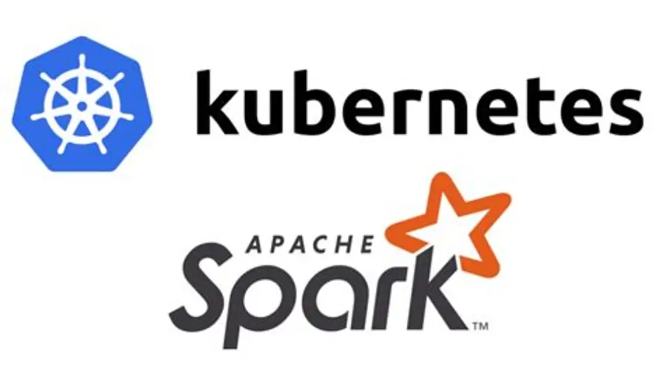
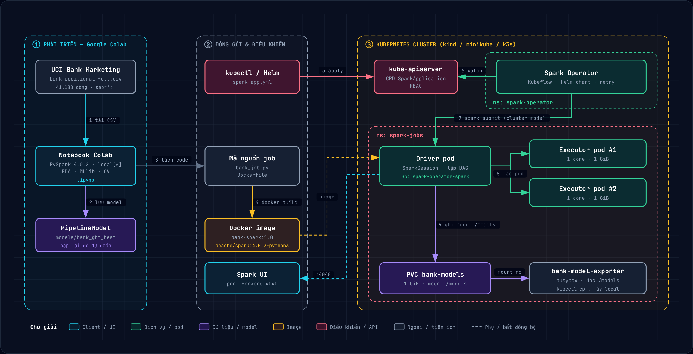
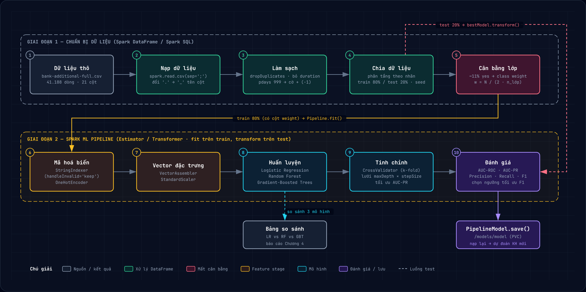

# Bank Marketing: Spark trên Kubernetes

<p align="center">
  
</p>

Dự án huấn luyện mô hình dự đoán khách hàng ngân hàng có đăng ký tiền gửi hay không, chạy bằng Apache Spark bên trong cụm Kubernetes.

Dữ liệu: UCI Bank Marketing, 41.188 dòng, 21 cột, file `data/bank-additional-full.csv` phân cách bằng dấu `;`.

Cách cài đặt và chạy nằm ở [Cach_trien_khai.md](Cach_trien_khai.md). File này mô tả hệ thống hoạt động ra sao.

## Vấn đề và giải pháp

Ngân hàng muốn biết nên gọi điện cho khách nào để không tốn công vào người sẽ từ chối. Dữ liệu mất cân bằng nặng, khoảng 89% khách trả lời "no" và 11% trả lời "yes".

Nếu chạy Python thường trên laptop, bạn gặp ba giới hạn: chỉ dùng được một CPU, hết RAM khi dữ liệu lớn, và model train xong nằm rải rác trên máy cá nhân khó mang lên server.

Spark giải quyết phần tính toán bằng cách chia dữ liệu ra nhiều tiến trình chạy song song. Kubernetes giải quyết phần hạ tầng: nó cấp phát tài nguyên, tạo và xoá tiến trình tự động, lưu kết quả vào ổ đĩa riêng. Docker đóng gói code để chạy được ở bất kỳ máy nào.

---

# Phần 1: Kiến trúc hệ thống



Sơ đồ chia làm ba vùng, đánh số theo thứ tự công việc đi qua.

## Vùng 1: Phát triển trên Google Colab

| Thành phần | Nội dung |
|---|---|
| UCI Bank Marketing | `bank-additional-full.csv`, 41.188 dòng, `sep=';'` |
| Notebook Colab | PySpark 4.0.2 chạy `local[*]`, làm EDA, MLlib, cross-validation, file `.ipynb` |
| PipelineModel | Kết quả lưu tại `models/bank_gbt_best`, nạp lại được để dự đoán |

Ba mũi tên trong vùng này: **1 tải CSV** đưa dữ liệu vào notebook, **2 lưu model** ghi kết quả ra PipelineModel, **3 tách code** chuyển logic đã chạy được sang file Python độc lập.

`local[*]` nghĩa là Spark chạy trên một máy duy nhất, dùng hết số CPU có sẵn. Đây là chế độ để thử nghiệm, chưa phải cụm thật.

## Vùng 2: Đóng gói và điều khiển

| Thành phần | Nội dung |
|---|---|
| Mã nguồn job | `bank_job.py` và `Dockerfile` |
| Docker image | `bank-spark:1.0`, dựng trên nền `apache/spark:4.0.2-python3` |
| kubectl / Helm | Gửi `spark-app.yml` lên cụm |
| Spark UI | Xem qua `port-forward 4040` |

Mũi tên **4 docker build** biến mã nguồn thành image. Mũi tên **5 apply** gửi manifest lên cụm.

Hai đường nét đứt là luồng phụ, không chạy đồng thời với luồng chính:
- Đường **image** nối Docker image sang Driver pod: cụm kéo image về khi cần tạo pod.
- Đường **:4040** nối Driver pod ngược về Spark UI: bạn mở giao diện khi job đang chạy.

Kubernetes không chạy file `.py` trực tiếp, nó chỉ chạy container. Image chứa sẵn Python, Spark và code của bạn nên copy sang máy khác vẫn chạy được.

## Vùng 3: Cụm Kubernetes

Cụm chạy trên kind, minikube hoặc k3s. Hướng dẫn triển khai dùng minikube.

### kube-apiserver

Cửa ngõ của mọi lệnh gửi vào Kubernetes. Nó giữ hai thứ liên quan đến dự án:

**CRD SparkApplication** là loại object mới mà Spark Operator thêm vào Kubernetes. Mặc định Kubernetes chỉ hiểu Pod, Service, Deployment. CRD (Custom Resource Definition) cho phép mở rộng thêm loại object riêng. Nhờ CRD này bạn mới viết được `kind: SparkApplication` trong file YAML.

**RBAC** (Role-Based Access Control) là hệ thống phân quyền. Nó quyết định pod nào được phép làm gì.

### Spark Operator (namespace `spark-operator`)

Operator là một chương trình chạy thường trực trong cụm, theo dõi object và tự động hành động khi thấy thay đổi.

Mũi tên **6 watch** chỉ việc Spark Operator liên tục hỏi kube-apiserver xem có `SparkApplication` mới không. Thấy có, nó thực hiện mũi tên **7 spark-submit (cluster mode)** để tạo Driver pod.

Ba chú thích trong box:
- **Kubeflow**: Spark Operator được bảo trì tại `github.com/kubeflow/spark-operator`, thuộc tổ chức Kubeflow trên GitHub. Dự án này chỉ dùng Spark Operator, không cài Kubeflow Pipelines hay bất kỳ thành phần nào khác của Kubeflow. Lệnh cài trong hướng dẫn là `helm repo add spark-operator https://kubeflow.github.io/spark-operator`, chữ kubeflow trong URL chính là lý do sơ đồ ghi vậy.
- **Helm chart**: cách cài Operator, phiên bản 2.6.0.
- **retry**: Operator tự tạo lại Driver khi job lỗi, theo `restartPolicy` trong `spark-app.yml` (tối đa 3 lần với `onFailureRetries`).

**Cluster mode** nghĩa là Driver chạy bên trong cụm dưới dạng pod. Ngược lại là client mode, Driver chạy trên máy bạn và chỉ Executor nằm trong cụm.

### Driver pod (namespace `spark-jobs`)

Driver là tiến trình điều phối toàn bộ job. Box ghi ba việc nó làm:

**SparkSession** là điểm vào của mọi chương trình Spark. Tạo nó xong bạn mới đọc được dữ liệu, mới gọi được các hàm xử lý.

**Lập DAG** là bước Spark đọc code và vẽ ra kế hoạch thực thi. DAG viết tắt của Directed Acyclic Graph, đồ thị có hướng không chu trình. Khi bạn viết `đọc CSV → lọc → mã hoá → train → lưu`, Spark không chạy ngay từng dòng. Nó ghi lại thành đồ thị, mỗi bước là một đỉnh, mũi tên là quan hệ phụ thuộc, và không có đường nào quay ngược về chỗ cũ. Sau đó Spark tối ưu đồ thị này, gộp các bước có thể làm chung một lượt để giảm số lần đọc ghi đĩa, rồi mới thực sự tính. Bạn xem DAG ở Spark UI cổng 4040, tab Stages.

**SA: spark-operator-spark** là ServiceAccount của Driver pod. ServiceAccount là danh tính mà Kubernetes gán cho pod, tương tự tài khoản đăng nhập của một người dùng. Kubernetes dựa vào danh tính này để xét quyền qua RBAC. Driver cần quyền tạo và xoá Executor pod, đọc ConfigMap, cập nhật trạng thái job. Helm chart cài Operator tạo sẵn ServiceAccount `spark-operator-spark` kèm đủ quyền. Nếu khai sai tên, Driver khởi động được nhưng không tạo nổi Executor và job dừng với lỗi `Forbidden`.

Khai báo trong [k8s/spark-app.yml](k8s/spark-app.yml):

```yaml
driver:
  cores: 1
  memory: "1g"
  serviceAccount: spark-operator-spark
  volumeMounts:
    - name: model-volume
      mountPath: /models
```

### Executor pod #1 và #2

Mỗi Executor có 1 core và 1 GiB RAM. Mũi tên **8 tạo pod** đi từ Driver sang hai Executor: Driver tự tạo chúng sau khi khởi động.

Executor nhận từng phần dữ liệu (partition), tính toán, trả kết quả về Driver. Hai Executor chạy song song nên khối lượng công việc chia đôi. Job xong thì cả hai tự xoá.

Cả Driver và Executor đều mount PVC vào `/models`. Nếu chỉ mount cho Driver, log sẽ báo `Mkdirs failed to create /models/...` vì Executor cũng cần ghi khi lưu model.

### PVC bank-models

PVC viết tắt của Persistent Volume Claim, là yêu cầu cấp một ổ đĩa trong cụm. Dung lượng 1 GiB, mount vào đường dẫn `/models`.

Mũi tên **9 ghi model /models** đi từ Driver pod xuống PVC. Sau khi train xong, Driver ghi PipelineModel vào đây.

Pod là thứ tạm thời, sinh ra để làm việc rồi biến mất, dữ liệu bên trong pod mất theo. PVC tồn tại độc lập nên model vẫn còn sau khi Driver và Executor đã xoá. PVC chỉ mất khi bạn chạy `kubectl delete pvc bank-models` hoặc `minikube delete` (lệnh này xoá cả cụm).

### bank-model-exporter

Pod phụ dùng để lấy model ra khỏi cụm. Ba dòng trong box:
- **busybox**: image Linux tối giản, chỉ cần đủ để pod sống và giữ volume mở.
- **đọc /models**: mount PVC ở chế độ chỉ đọc, ghi trên nhãn mũi tên là `mount ro` (read-only).
- **kubectl cp → máy local**: lệnh copy file từ pod về máy bạn.

Cần pod này vì `kubectl cp` yêu cầu pod đang chạy. Driver pod lúc đó đã `Completed` nên không copy từ đó được.

```powershell
kubectl apply -f k8s\model-exporter.yml
kubectl cp spark-jobs/bank-model-exporter:/models/bank_gbt_best .\bank_gbt_best
kubectl delete -f k8s\model-exporter.yml
```

### Chú giải màu

| Màu | Nhóm |
|---|---|
| Xanh dương | Client hoặc giao diện |
| Xanh lá | Dịch vụ, pod |
| Tím | Dữ liệu, model |
| Vàng | Docker image |
| Đỏ | Điều khiển, API |
| Xám | Thành phần ngoài, tiện ích |
| Nét đứt | Luồng phụ hoặc bất đồng bộ |

---

# Phần 2: Luồng dữ liệu ML



Mười bước, chia hai giai đoạn. Giai đoạn 1 xử lý dữ liệu thô bằng Spark DataFrame và Spark SQL. Giai đoạn 2 là Spark ML Pipeline gồm các Estimator và Transformer, fit trên tập train rồi transform trên tập test.

## Giai đoạn 1: Chuẩn bị dữ liệu

### 1. Dữ liệu thô

`bank-additional-full.csv`, 41.188 dòng, 21 cột.

### 2. Nạp dữ liệu

`spark.read.csv(sep=';')` đọc file. Sau đó đổi dấu `.` thành `_` trong tên cột, vì Spark SQL hiểu dấu chấm là ký hiệu truy cập cột con nên tên như `emp.var.rate` gây lỗi.

### 3. Làm sạch

Ba việc:

`dropDuplicates` xoá dòng trùng lặp.

Bỏ cột `duration`. Đây là thời gian cuộc gọi tính bằng giây. Bạn chỉ biết con số này sau khi cuộc gọi kết thúc, tức là sau khi đã có kết quả. Dùng nó để train thì model đạt điểm rất cao trên giấy nhưng vô dụng lúc dự đoán thật, vì lúc gọi bạn chưa biết cuộc gọi sẽ kéo dài bao lâu. Lỗi này gọi là data leakage.

Cột `pdays` ghi số ngày kể từ lần liên hệ trước, riêng giá trị 999 nghĩa là chưa từng liên hệ. Nếu để nguyên, model hiểu nhầm 999 là "rất lâu rồi" và xếp cạnh các giá trị lớn khác. Cách xử lý: tách thành một cột cờ đánh dấu chưa liên hệ, và đổi 999 thành -1.

### 4. Chia dữ liệu

Train 80%, test 20%, phân tầng theo nhãn, cố định `seed`.

Phân tầng nghĩa là giữ nguyên tỷ lệ yes/no ở cả hai tập. Chia ngẫu nhiên thường có thể làm tập test chứa quá ít mẫu "yes" và điểm đánh giá mất ý nghĩa. `seed` cố định giúp chạy lại cho ra đúng cách chia cũ.

### 5. Cân bằng lớp

Chỉ khoảng 11% dòng có nhãn "yes". Model học trên dữ liệu này dễ rơi vào trạng thái đoán "no" cho mọi khách và vẫn đạt độ chính xác 89%, nhưng không tìm được khách nào tiềm năng.

Cách xử lý là gán trọng số cho từng lớp theo công thức `w = N / (2 · n_lớp)`, với N là tổng số dòng và `n_lớp` là số dòng của lớp đó. Lớp thiểu số nhận trọng số lớn hơn nên mỗi lần đoán sai nó, model bị phạt nặng hơn.

Tập train sau bước này có thêm cột weight, rồi đi vào `Pipeline.fit()`. Tập test 20% đi thẳng xuống bước 10 qua `bestModel.transform()`, đường nét đứt màu đỏ ở sơ đồ.

## Giai đoạn 2: Spark ML Pipeline

### 6. Mã hoá biến

`StringIndexer` đổi giá trị chữ thành số, ví dụ `job` có các giá trị `admin`, `blue-collar`, `technician` thành 0, 1, 2. Tham số `handleInvalid='keep'` xử lý trường hợp tập test xuất hiện giá trị chưa từng thấy lúc train: thay vì báo lỗi, nó gom vào một nhóm riêng.

`OneHotEncoder` tách số đó thành nhiều cột 0/1. Lý do: để nguyên số thì model hiểu nhầm có thứ tự, kiểu technician (2) lớn hơn admin (0), trong khi nghề nghiệp không có thứ tự nào cả.

### 7. Vector đặc trưng

`VectorAssembler` gom tất cả cột đã xử lý thành một cột vector duy nhất. Spark MLlib chỉ nhận đầu vào ở dạng này.

`StandardScaler` đưa các cột số về cùng thang đo. Tuổi nằm trong khoảng 17 đến 98, còn một số chỉ số kinh tế chỉ dao động quanh 0. Không chuẩn hoá thì cột có giá trị lớn lấn át cột giá trị nhỏ.

### 8. Huấn luyện

Train ba model để so sánh:

Logistic Regression là model tuyến tính, nhanh, dễ giải thích, dùng làm mốc so sánh.

Random Forest dựng nhiều cây quyết định độc lập rồi lấy kết quả theo đa số.

Gradient-Boosted Trees dựng cây tuần tự, mỗi cây mới học sửa lỗi của các cây trước. Thường cho kết quả tốt nhất với dữ liệu dạng bảng, và đây là model được chọn cuối cùng.

Nhánh nét đứt đi xuống **Bảng so sánh** ghi lại kết quả LR, RF và GBT cho báo cáo Chương 4.

### 9. Tinh chỉnh

`CrossValidator` chạy k-fold cross-validation: chia tập train thành k phần, lần lượt lấy một phần làm validation và k-1 phần còn lại để train, rồi lấy trung bình điểm.

Lưới tham số quét `maxDepth` (độ sâu tối đa của cây) nhân với `stepSize` (tốc độ học). Mỗi tổ hợp được chấm điểm bằng AUC-PR, tổ hợp cao điểm nhất thắng.

### 10. Đánh giá

Năm chỉ số: AUC-ROC, AUC-PR, Precision, Recall, F1. Thêm một bước chọn ngưỡng cắt tối ưu F1.

Về AUC-PR và AUC-ROC: khi lớp dương chỉ chiếm 11%, AUC-ROC vẫn cho điểm cao ngay cả với model kém, vì nó tính cả khả năng nhận đúng lớp "no" vốn quá dễ. AUC-PR chỉ nhìn vào lớp thiểu số nên phản ánh đúng việc model có tìm được khách tiềm năng hay không.

Ngưỡng cắt là mức xác suất để quyết định gọi hay không. Mặc định là 0.5, nhưng với dữ liệu lệch thì mức khác thường cho F1 cao hơn.

## Kết quả

`PipelineModel.save()` ghi model vào `/models/model` trên PVC. Nạp lại bằng `PipelineModel.load()` để dự đoán khách hàng mới mà không cần train lại.

Sau khi export về máy, thư mục `bank_gbt_best` có:

```
bank_gbt_best/
├── model/            Model GBT đã train
├── metrics.json      Số dòng dữ liệu, AUC-PR, F1
├── predictions/      Dự đoán tập test dạng CSV (cột actual và predicted)
└── job.log           Log lần chạy
```

Job đang chạy ở chế độ demo với mẫu phân tầng 10% dữ liệu, đủ nhanh để thử. Muốn kết quả dùng được thật thì train trên toàn bộ dữ liệu.

---

# Cấu trúc thư mục

```
bank-marketing-spark-k8s/
├── src/bank_job.py          Toàn bộ logic ML pipeline
├── k8s/
│   ├── spark-app.yml        Khai báo SparkApplication
│   ├── model-pvc.yml        Khai báo PVC bank-models
│   └── model-exporter.yml   Pod copy model ra máy local
├── data/bank-additional-full.csv
├── notebooks/               Notebook Colab
├── docs/                    Sơ đồ kiến trúc và pipeline
├── Dockerfile
├── requirements.txt
├── Cach_trien_khai.md       Hướng dẫn cài và chạy
└── bank_gbt_best/           Kết quả export về
```

# Từ điển thuật ngữ

| Từ | Nghĩa |
|---|---|
| Pod | Đơn vị chạy nhỏ nhất của Kubernetes, chứa một hoặc nhiều container |
| Namespace | Nhóm tách biệt tài nguyên trong cụm. Dự án dùng `spark-operator` và `spark-jobs` |
| CRD | Custom Resource Definition, cho phép thêm loại object mới vào Kubernetes |
| RBAC | Role-Based Access Control, hệ thống phân quyền |
| SA | ServiceAccount, danh tính của pod để xét quyền |
| PVC | Persistent Volume Claim, ổ đĩa tồn tại độc lập với pod |
| DAG | Kế hoạch thực thi của Spark, đồ thị có hướng không chu trình |
| Driver | Pod điều phối job, lập DAG và tạo Executor |
| Executor | Pod tính toán song song |
| Cluster mode | Driver chạy bên trong cụm dưới dạng pod |
| Spark Operator | Controller theo dõi SparkApplication và tạo pod tương ứng |
| Estimator | Thành phần MLlib có hàm `fit()`, học từ dữ liệu |
| Transformer | Thành phần MLlib có hàm `transform()`, biến đổi dữ liệu |
| Data leakage | Dùng thông tin chỉ có sau khi biết kết quả để train |
| AUC-PR | Area Under Precision-Recall Curve, chỉ số phù hợp với dữ liệu mất cân bằng |
